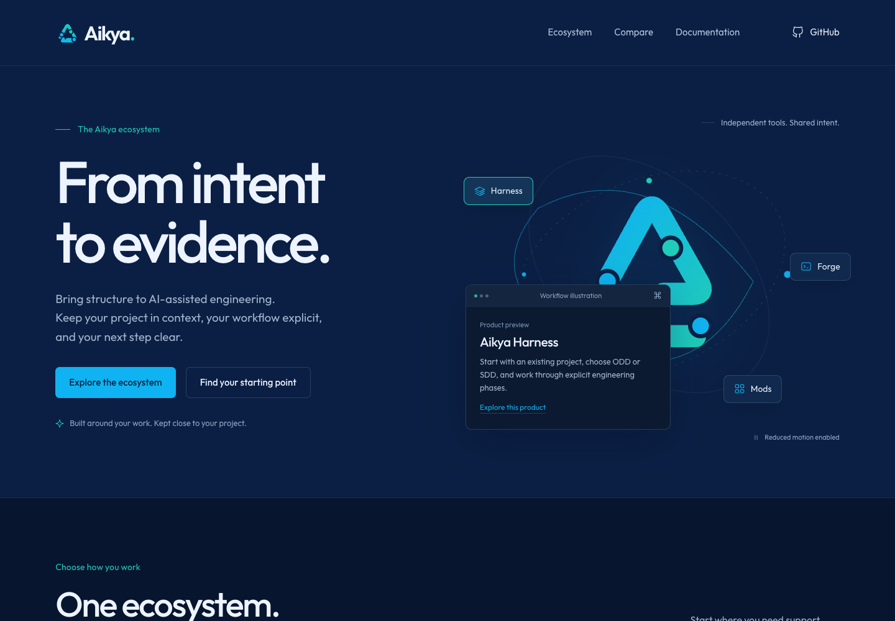

# Aikya ecosystem portal

Public product website for **Aikya Harness**, **Aikya Forge** and **Aikya Mods**.
Harness and Forge are independent products. The portal explains their roles and
links their canonical documentation and releases; it does not distribute installers.



## Languages

The complete portal is available in [English](https://jlema0590.github.io/aikya-page/)
and [Spanish](https://jlema0590.github.io/aikya-page/es/). The EN/ES button-like toggle opens
the equivalent page, including without JavaScript. Language choice is explicit;
there are no automatic redirects or external translation services.

## Local preview

Requires Node.js 22+ for the local build. The deployed website is static and has
no runtime dependencies or model calls.

```sh
npm ci --ignore-scripts --no-audit --no-fund
npm run build
npm run dev
```

Open http://127.0.0.1:4178/aikya-page/.

## Edit content and appearance

- `src/products.mjs`: verified product descriptions, requirements and upstream links.
- `src/templates.mjs`: landing page, product pages and comparison/getting-started guides.
- `src/es.mjs`: reviewed Spanish copy, preserving product names, commands and English phase names.
- `src/installation.mjs`: verified OS commands and shared installation panels.
- `assets/installation.css`: scrollable command blocks and native OS disclosures.
- `src/i18n.mjs`: build-time translation, equivalent-page links and language metadata.
- `assets/style.css`: entry point for base, responsive and motion styles.
- `assets/base.css`: layout and the original Aikya navy/cyan/turquoise palette.
- `assets/responsive.css` / `assets/motion.css`: screen adaptation and accessible animation.
- `assets/app.mjs`: progressive product selection and motion controls.
- `assets/fonts/`: self-hosted Outfit font and its original SIL Open Font License.
- `scripts/build.mjs`: generate the deployable `site/` directory.

The primary palette is taken from the Aikya Forge brand tokens: navy `#0b1f44`,
cyan `#0fb3f1`, turquoise `#1fccba`, text `#edf4ff`, panel `#112139`.
The standalone SVG mark is a clean vector trace based on the original
[Aikya logo](https://github.com/jlema0590/aikya-harness/blob/main/docs/images/aikya-harness.png),
with geometric circular nodes. Its orbital illustration uses true circles;

its terminal/phase panels are explicitly illustrative, not actual execution evidence.

Content sources checked on 2026-11-23:

- [Harness README](https://github.com/jlema0590/aikya-harness#readme).
- [Forge README](https://github.com/jlema0590/aikya-forge#readme).
- [Mods README](https://github.com/jlema0590/aikya-mods#readme).
- Public latest stable releases: Harness v7.2.2, Mods v0.0.10; Forge has no stable
  public release at the content check. Main-branch docs can describe newer features.

The installation panels use published Harness Pages scripts and the pinned v0.0.10
Mods standalone installer (Git required), with Flow/Usage selected and BoxBot optional.
Forge retains source-only instructions. The website displays and copies these commands;
it never executes installers. Recheck public release availability before updating them.

Both locales share the same verified product data. Add translations for new editorial
text to `src/es.mjs`; the build fails if Spanish copy is missing. Internal navigation
stays within the selected language, while upstream documentation keeps its original URL.

Recheck the release status before changing availability labels. Do not add
unavailable curl commands, performance claims, usage percentages or unsupported
integrations. Each product repository owns its technical documentation and releases.

## Tests

```sh
npx playwright install chromium
npm test
```

Tests cover real generated links/assets, twelve English/Spanish routes, equivalent-page
language switching, translated product and motion controls, keyboard product selection,
pause/resume, reduced motion, desktop/mobile layout, no-script access and Forge's
source-only guidance. CI installs its own matching Chromium. To reuse an existing
Chromium locally, set `PLAYWRIGHT_CHROMIUM_EXECUTABLE_PATH` to its executable.

## GitHub Pages

The workflow checks pull requests and deploys site-affecting main pushes/manual runs after tests.
In repository Settings → Pages choose **GitHub Actions**. The intended project URL
is https://jlema0590.github.io/aikya-page/.

Product installer URLs remain in their own repositories/Pages. This portal has its
own release/deployment lifecycle and does not trigger a Harness, Forge or Mods release.

## License

MIT for portal code. Outfit retains its original [SIL OFL](assets/fonts/OFL.txt),
from the [Google Fonts repository](https://github.com/google/fonts/tree/main/ofl/outfit).
